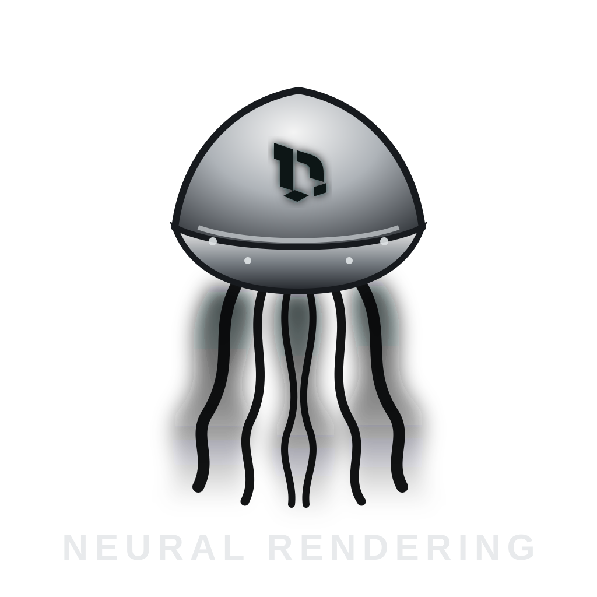

# PS4 Neural Engine — diagnostics and integration scaffold

  

Public source repository for the PS4 Neural Engine project. The currently implemented runtime is the **GoldHEN diagnostics/capture scaffold**, not a completed neural renderer.

## Official project identity

The official Neural Rendering mark is the monochrome jellyfish-shaped UFO, with a small PlayStation-inspired mark on its dome, fading black smoke/tentacles, and the **NEURAL RENDERING** wordmark beneath it. The source artwork is maintained at [assets/neural-rendering-logo.svg](assets/neural-rendering-logo.svg).

## Implemented

- Bounded, non-blocking presentation-event queue and worker-thread file writer.
- Explicit capture sessions; capture is OFF by default.
- CSV frame-time telemetry.
- BMP export only from CPU-readable RGBA8 staging memory provided by a verified title-specific adapter.
- OpenOrbis/GoldHEN PRX cross-build workflow, a homebrew PKG installer pipeline, and a PRX-only ZIP for GoldHEN's local Plugin Source updater.
- PKG installer app copies the PRX to `/data/GoldHEN/plugins` and registers it in `/data/GoldHEN/plugins.ini`.

## Build and validation

- Host CMake tests: automated through `.github/workflows/host-tests.yml`.
- PS4 cross-build and installer PKG: `.github/workflows/ps4-prx.yml`, pinned to OpenOrbis Toolchain v0.5.4 and GoldHEN_Plugins_SDK commit `bcea3c7ef01dac6d7f9f49ebf9e90fe66d86f5f7`; a non-empty PRX and PKG passed the CI build and package validation.
- Local PRX compilation is not equivalent to loading the plugin on a console. Firmware 14.02 / GoldHEN runtime validation remains outstanding.
- PKG installer usage: see `docs/PKG_INSTALLER.md`.
- GoldHEN Plugin Source archive usage: see `docs/GOLDHEN_PLUGIN_ARCHIVE.md`. The ZIP contains only the PRX and never overwrites `plugins.ini`.

## Hardware boundary

A generic `sceGnmSubmitAndFlipCommandBuffers` hook observes presentation submissions and timing metadata. It does **not** provide a safe CPU-readable framebuffer. Frame capture requires a per-title adapter that owns render-target access, performs supported GPU readback, waits for completion, handles cache coherency, and validates dimensions and row pitch.

No generic framebuffer interception, GNM compute backend, neural inference runtime, temporal reconstruction, or universal per-game rendering path is implemented yet. The PS4 Pro uses AMD GCN hardware; NVIDIA DLSS binaries, Tensor Core paths, and proprietary weights are not portable to it.

## Capture controls and privacy

- Capture is OFF by default and starts only after an explicit controller action.
- Frames and logs remain on the console until the user exports them.
- Never embed a GitHub token in a PRX, PKG, source file, or diagnostics archive.
- Review captures for account names, chat, personal information, and copyrighted material before publishing to a public repository.

## Layout

- `assets/neural-rendering-logo.svg`: official project logo (editable vector source).
- `src/telemetry.cpp`: CSV/BMP writer.
- `src/telemetry_bridge.cpp`: bounded producer queue and worker.
- `include/pne/telemetry.hpp`: telemetry API.
- `platform/ps4/goldhen/plugin/`: GoldHEN PRX and cross-build Makefile.
- `installer/`: console-side PKG installer app.
- `tools/build_pkg.sh`: PKG generation and validation.
- `docs/UPLOAD.md`: reviewed manual diagnostics upload procedure.

This repository is an integration foundation, not a finished in-game neural renderer. CI builds do not prove PS4 Pro / firmware 14.02 runtime compatibility.
